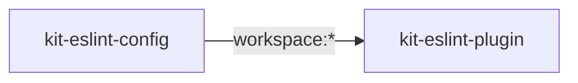
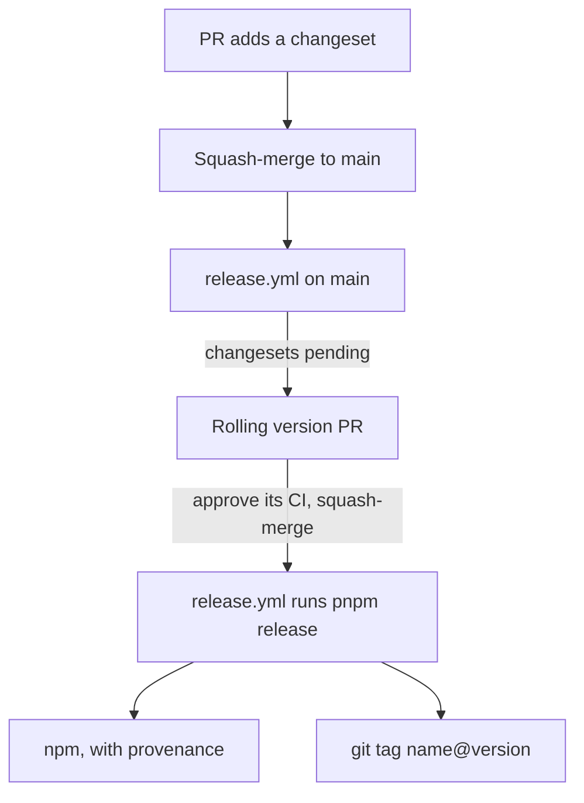

# Architecture

- **As of 2026-11-26.** The workspace, CI and release pipeline are in place;
  `kit-changesets-changelog` (#4) is the first package built, and
  `require-changeset` and `version-or-release` (#5) the first actions.
- Each package and action issue updates this page in the same PR.
- Why it's built this way is in the [decisions bundle](../decisions/index.md).

## Layout

- `packages/<name>/`: one npm package each, `@jjloneman/kit-<name>`, with its
  own `package.json`, `tsconfig.json` and `CHANGELOG.md`, and a
  `tsdown.config.ts` unless it ships JSON only, as `kit-tsconfig` does.
- `actions/<name>/`: one composite GitHub Action each, referenced as
  `jjloneman/jj-kit/actions/<name>`.
  - Each has a private `package.json` in the workspace, so Changesets versions,
    changelogs and tags it (see
    [How the actions are versioned](../decisions/action-versions.md)).
  - An action's logic is zero-dependency TypeScript in its `src/`, which Node
    runs unbuilt under type stripping, tested like a package's.
  - `actions/lib/` holds the code both actions share, imported by relative path;
    it's a private package, but not an action.
- `docs/decisions/` and `docs/references/`: the two OKF bundles.
- `.changeset/`: pending changesets and the Changesets config.
- `.github/`: `workflows/ci.yml`, `workflows/release.yml`, the ruleset
  protecting `main`, and the setup action #6 replaces.
- Root configs:
  - ESLint, Prettier and TypeScript, each copied from okf-tools until its
    package lands;
  - Vitest, which runs every package's tests as one workspace and has no kit
    package.

## Packages

| Package                    | What it ships                                                             | Issue |
| -------------------------- | ------------------------------------------------------------------------- | ----- |
| `kit-changesets-changelog` | A Changesets changelog formatter with each commit's gitmoji and scope     | #4    |
| `kit-eslint-config`        | A typed `defineConfig(options)` for flat-config ESLint                    | #10   |
| `kit-eslint-plugin`        | The kit's own ESLint rules, starting with `no-dotted-jsdoc-param`         | #9    |
| `kit-git-hooks`            | The `kit-pre-commit` and `kit-pre-push` commands                          | #11   |
| `kit-prettier-config`      | A base Prettier config, and a variant for zsh scripts                     | #7    |
| `kit-tsconfig`             | `base.json`, `node.json`, `bundler.json` and `lib.json`, by how code runs | #8    |

- Every package is ESM-only, declares `engines.node: ">=26"`, and builds into
  `dist/` with tsdown, except `kit-tsconfig`, which ships JSON only.
- Tools a package configures, such as ESLint, Prettier and TypeScript, are peer
  dependencies, so the consumer picks the version within the range.

### Dependency graph

- `kit-eslint-config` depends on `kit-eslint-plugin` as `workspace:*`, published
  as an exact version.
- No other package depends on another kit package.

## Actions

| Action               | What it does                                                                               | Issue |
| -------------------- | ------------------------------------------------------------------------------------------ | ----- |
| `require-changeset`  | Fails a PR that adds no changeset; skips the version PR and Renovate PRs that ship nothing | #5    |
| `setup`              | Installs pnpm, Node and the frozen-lockfile dependency tree                                | #6    |
| `version-or-release` | Opens the rolling version PR, or publishes once it merges, then labels and assigns it      | #5    |

## CI

- `ci.yml` runs on every PR and every push to `main`, on Node 26:
  - `🧹 Lint & format`;
  - `🔷 Typecheck`;
  - `🧪 Tests`, with a 100% coverage gate over `actions/*/src` and
    `packages/*/src`;
  - `📦 Package`, which builds each package and checks it with publint and attw;
  - `🦋 Changeset`, on PRs only, through `./actions/require-changeset`.
- `release.yml` runs `./actions/version-or-release` on every push to `main`.
- jj-kit uses its own actions by local path, so a PR's CI runs them as the PR
  changes them.
- Every `ci.yml` job is a required check on `main`, through
  `.github/rulesets/main.json`.

## Release flow

1. **A PR adds a changeset**, naming each package it bumps, or an empty one when
   it ships nothing; CI's `🦋 Changeset` job fails it otherwise.
2. **On each push to `main`**, `release.yml`, through `version-or-release`,
   keeps a rolling `chore(release): 🚀 version packages` PR open while non-empty
   changesets are pending, labeled `🚀 release` and assigned to `jjloneman`.
3. **The version PR's CI run waits for approval**, since `GITHUB_TOKEN` opened
   it; the owner approves it, then squash-merges it.
4. **That merge bumps each package's version and writes its `CHANGELOG.md`.**
   - Each line comes from `kit-changesets-changelog`, which jj-kit loads from
     its source under Node's type stripping, so versioning needs no build.
5. **The run on the merge runs `pnpm release`**
   (`pnpm build && changeset publish`); it publishes every version npm doesn't
   have yet through npm trusted publishing, with signed provenance, and tags
   each package and action as `<name>@<version>`.

- A package's first version is published by hand, with `--provenance=false`,
  before trusted publishing can be set up for it.
- Empty changesets never release; a run with only empty ones pending opens no
  version PR, and instead publishes anything npm doesn't have yet (see
  [Why empty changesets don't block a publish](../decisions/publish-past-empty-changesets.md)).
